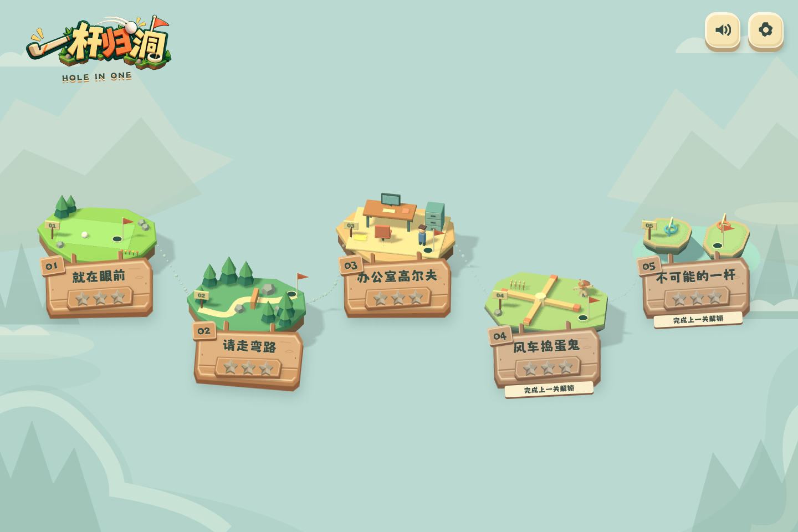
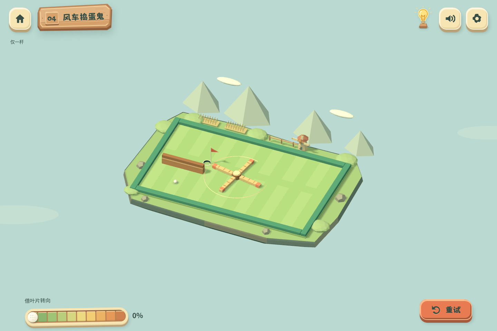
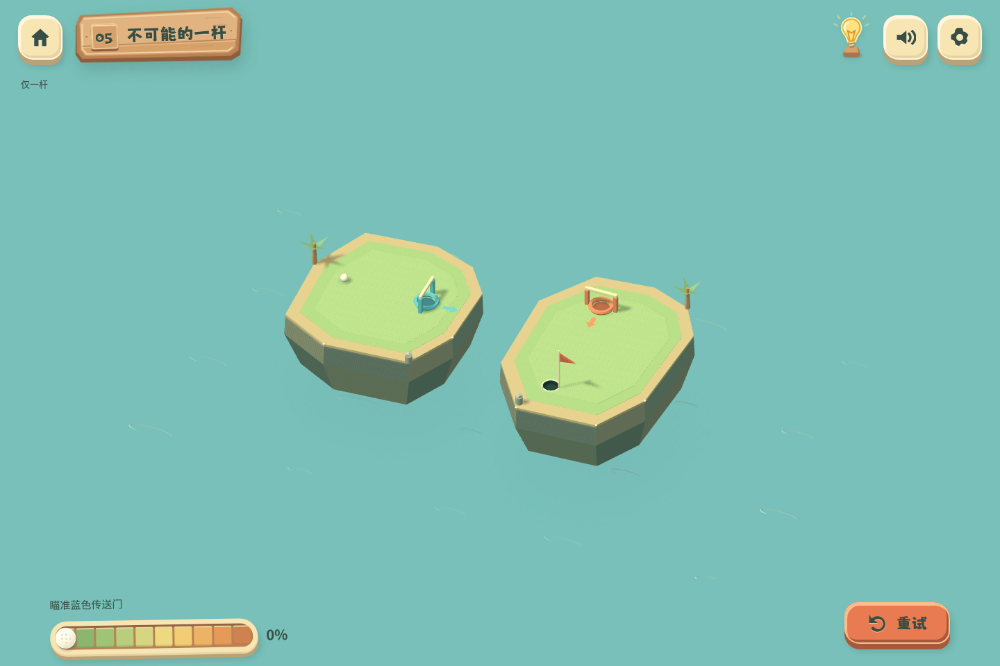

# 一杆归洞

Three.js + TypeScript + Vite 的五关 2.5D 高尔夫解谜。拖拽、松手，一杆进洞。低多边形微缩岛屿、固定正交视角和玩具木牌 UI；无后端或运行时 CDN。



## 浏览器试玩

预期 Pages 地址：<https://shubing19970420-afk.github.io/crispy-fortnight/>。

开发分支 `game/one-shot-golf-prototype` 每次推送自动执行 `.github/workflows/deploy-pages.yml`：锁定依赖安装、物理测试、构建、生产子目录浏览器检查、Pages 发布、线上资源检查。不会合并 main。首次启用需由仓库管理员在 [Settings → Pages](https://github.com/shubing19970420-afk/crispy-fortnight/settings/pages) 将 Source 设为 **GitHub Actions**；若部署环境限制分支，允许 `github-pages` 环境使用开发分支，再重跑 [部署工作流](https://github.com/shubing19970420-afk/crispy-fortnight/actions/workflows/deploy-pages.yml)。

当前云环境访问 GitHub API 和 github.io 被代理以403拒绝，因此无法确认公网状态。上述地址须以 Actions 部署成功和线上检查通过为准。已在 Chromium 中验证生产包的相同 `/crispy-fortnight/` 子路径：Logo、本地字体、脚本、五关和路线 Worker 无缺失资源。CI 会将实际浏览器截图与报告作为 `pages-browser-checks` 附件保留。

## 本地启动

安装 Node.js 22 LTS，在项目目录运行：

```sh
npm ci
npm run dev
```

浏览器打开 `http://localhost:5173`。Vite 默认监听 `0.0.0.0`，手机与电脑处于同一局域网时可使用电脑的局域网 IP。生产构建为 `npm run build`，预览为 `npm run preview`；`dist/` 可交由静态 HTTP 服务器托管。不要双击 HTML 文件运行模块游戏。

## 五个关卡

| 关卡 | 玩法 |
| --- | --- |
| 01 就在眼前 | 开阔草地，学习方向和力度 |
| 02 请走弯路 | 森林 Z 型双折返，穿北缺口、南缺口，借上下边墙反弹 |
| 03 办公室高尔夫 | 家具间绕行；桌底可穿，桌腿会挡；观察固定周期巡逻的同事 |
| 04 风车捣蛋鬼 | 山地田园主题；绕过木墙，借顺时针叶片把球转向洞口，让障碍成为帮手 |
| 05 不可能的一杆 | 海上悬浮岩岛，利用蓝橙传送门和出口朝向完成一杆 |

原三关继续开放，配置、场景、镜头及物理参数不变。04在完成03后解锁，05在完成04后解锁；旧进度与最佳成绩保留。新两岛与原三岛共用渲染器，岛屿／木牌可点击选择；横屏为01、03、05偏上，02、04偏下的交错五关路线，连接严格按编号推进；手机使用可上下滚动的纵向路线，返回选关恢复原滚动位置。已完成路径更亮，未解锁路径更淡。




## 操作、提示与成绩

- 点击岛屿或木牌进关，首页不再使用开始按钮。原始透明 PNG Logo 保留，新增装饰副标 `HOLE IN ONE`。
- 按住白球向后拉，箭头指向出球方向，松手击球；运动中不能再击球。小拖拽不会发射。力度计只反映现有拖拽算法。
- 球经过有效洞口即成功，连续扫掠判定避免高速漏洞；停在洞外或离开第五关小岛会失败，可立即重试。
- 第三关起，右上角音量左侧的灯泡可展开／收起路线木牌；击球时自动收起。不自动击球，也不改变碰撞或镜头。
- 连续失败三次会主动提供提示入口，重试与刷新保留失败统计，通关清零。没有可验证路线时只提示等待，不展示假路线。
- 风车、同事的模拟时钟从每次进关／重试的0开始，瞄准期间推进；打开设置或页面进入后台会暂停，不追赶丢失的时间。低帧率下模拟时间可能慢于钟表时间。
- 没有强制倒计时。成绩为出杆到捕获的模拟耗时，保留两位小数，等候瞄准不计入成绩。每关独立最佳使用 `golf-best-v4`，进度使用 `golf-progress-v4`；只有百分之一秒成绩真正改善才显示新纪录。
- 首页星星延续既有通关评价：有效最佳≤3.00秒三星、≤5.00秒二星，其余一星；未通关零星，旧进度无耗时记录时一星。星星不是难度或解锁等级。
- 音乐默认关闭，音效与音乐可分别设置并保存；用户操作后才启动音频，后台暂停。失败弹窗保留「再来一杆！」和重试／选关操作，增加球、洞口及旗杆小景。

路线使用同一物理函数在 Worker 中回放。办公室提示保留原有巡逻安全检查；风车提示在0.6秒释放窗口按0.025秒间隔重放，成功才显示。旧快照超过0.25秒撤下并重新验证；仍需观察并及时出杆，极端掉帧或延迟释放可能错过窗口。传送轨迹在入口、出口分段绘制，既不在地图上、也不在球场上画出跨越虚空的假球路。

## 实现与资源

| 文件 | 职责 |
| --- | --- |
| `src/main.ts` | 界面、输入、状态、解锁、设置、成绩流程 |
| `src/levels.ts` | 五关坐标、碰撞体、家具、巡逻、风车与双岛传送门配置 |
| `src/physics.ts` | 240Hz二维物理、连续碰撞／进洞、相对运动反弹、传送事件 |
| `src/scene.ts`、`src/course-models.ts` | 共用 Three.js 渲染器、原三关模型、二维到XZ坐标映射 |
| `src/special-models.ts`、`src/diorama-art.ts` | 击球风车／传送门、田园台地、山峦麦田、立式风车屋、岩岛及海面 |
| `src/menu-backdrop.ts` | 原创低饱和远山、树林轮廓、河流与云影背景 |
| `src/world-map.ts` | 五岛菜单、射线选中、悬停与进入过场 |
| `src/route-hints.ts`、`src/route-worker.ts`、`src/route-map.ts` | 真实回放、后台搜索和碰撞地图 |
| `src/records.ts`、`src/ui-kit.ts` | 五关成绩读取、结算分类、原有星章评价 |
| `src/iteration.css`、`src/world-refresh.css` | 玩具界面、正常比例正文、居中失败提示、滚动地图与响应式排版 |

风车叶片在旋转坐标系中执行与家具相同的扫掠碰撞，再按接触点的表面速度反弹；240Hz下本关每步转角约0.12°，大步长会细分。传送入口采用连续圆形检测，与墙、洞口比较事件先后，传送时旋转速度向量并保持其长度，随后正常扣除摩擦；出口偏移和短冷却防止立即来回传送。门框立柱具有与模型相同的真实碰撞体，横梁位于球可穿过的高度。新机制仅在对应关卡的可选配置存在时启用，不改变原三关的摩擦、反弹和捕获规则。

Logo为用户提供的 `src/assets/game-logo.png`（2023×777 RGBA），原始比例及字形保留，文件未修改。模型、UI 矢量、击球音效和音乐由程序原创生成，未裁切参考图作界面。

本地字体与许可证在 `public/fonts/`：标题／按钮为猫啃什锦黑1.70（作者官方发行，SIL OFL1.1）；辅助文字与数字统一为正常宽高比例的 Golf UI Sans 400／700，基于合法 Noto Sans CJK SC 2.004 的改名界面子集，两个本地 WOFF2 共约230KB。包含设置、说明、提示、成绩标签和数字；未压缩字形或使用窄长装饰字体。OFL全文、版权、包来源及脚本见 `public/fonts/golf-ui/`。旧黄油体／得意黑保留授权作为兼容资源，不再用于正式辅助文字。完整来源、版本、许可证和散列见 [字体说明](public/fonts/README.md)、`font-manifest.json` 与 `SHA256SUMS`。

## 测试与实际截图

```sh
npm test
npm run build
# 下面的浏览器测试需要先运行 npm run dev，并安装 Chromium：
npm run test:art
npm run test:expansion
node tests/office-pointer.mjs
node tests/menu.mjs
# 直接检查生产包（不使用开发调试接口）：
CHROMIUM_PATH=/usr/bin/chromium node tests/pages.mjs
```

物理测试保留原三关的一杆逐步回放、18组相邻解、所有原障碍碰撞、移动人物相对反弹、连续捕获和240组压力杆。新增风车精确重试、61个连续放杆时刻、相邻方向／力度、移动叶片传递速度及逐步无穿透检查；传送门15组容错解、方向／速率、防循环、坠落、分段轨迹和五关成绩；另有240组新机制压力杆。

浏览器检查覆盖真实鼠标出杆、五关选关／重试、第四到第五关、顺序解锁、真实成绩星章、设置、提示开关，以及桌面、390px、320px布局。`tests/menu.mjs`检查五岛射线点击、键盘、真实触屏事件和重复进出的资源释放。生产检查验证项目子路径下的资源、字体解码、原 Logo、WebGL、五关及后台路线 Worker。

实际 Chromium 截图：

- [桌面首页](docs/screenshots/latest-menu.png)／[390px首页](docs/screenshots/latest-menu-390.png)／[320px首页](docs/screenshots/latest-menu-320.png)
- [第一关](docs/screenshots/latest-level-1.png)／[第二关](docs/screenshots/latest-level-2.png)／[第三关](docs/screenshots/latest-level-3.png)／[第四关](docs/screenshots/art-level-4-desktop.png)／[第五关](docs/screenshots/art-level-5-desktop.png)
- [失败界面](docs/screenshots/iteration-failure.png)／[设置](docs/screenshots/iteration-settings-1280.png)／[手机设置](docs/screenshots/iteration-settings-390.png)

参考杆（角度为二维物理平面弧度，拖拽单位最大150）：01为0／65；02为−1.06／125；03为−0.748／125且需观察同事时机。04可在重试后约0～0.6秒以−0.41／95出杆，或等灯泡推荐窗口；05朝蓝门水平向右，力度65～75。

尚需确认：实体手机触感、音效听感和低端设备帧率；浏览器截图使用软件 WebGL。Three.js 主包仍有 Vite 默认500KB体积警告，构建成功。五关仍不代表已经达到最终30分钟以上体验目标，作业截止为10月19日23:59。

## 本轮美术预览与验收

- 04的球场仍是原来平整、同坐标的击球区域，围墙、木墙及水平叶片参数不变；外圈新增不规则台地、岩石层、起伏草坡、麦田、围栏、云和浅色山峦。远处立式风车屋只做气氛动画，不能当作击球叶片。
- 05取消方形草板：岛面、沙岸与岩层来自同一份不规则多边形；物理坠落判定也读取该轮廓，并留球半径的安全内缩。起球点、洞口及两门坐标未移动，已验证的传送解仍成立。海面在岛下，岛屿顶面保持Y=0，不作与碰撞脱节的浮动。仅波纹亮斑动画；棕榈、岸石与实际碰撞体对应。缩略岛屿同步使用田园及双岩岛主题。
- 首页为原创轻量矢量背景与实时三维岛屿组合，未裁切参考图作背景。所有组件仍可交互，复用同一 Three.js renderer。
- 失败插画缩小，标题移至卡片中心附近并略缩小，与底部两按钮保持留白。胜利与新纪录的结构保留，仅统一其中辅助文字的正常比例字体。

本轮真实截图：

[桌面地图](docs/screenshots/art-menu-desktop.png) · [横屏紧凑地图](docs/screenshots/art-menu-landscape.png) · [手机地图上段](docs/screenshots/art-menu-mobile.png) · [手机地图下段](docs/screenshots/art-menu-mobile-bottom.png)

[山地田园关](docs/screenshots/art-level-4-desktop.png) · [海上岩岛关](docs/screenshots/art-level-5-desktop.png) · [手机田园关](docs/screenshots/art-level-4-mobile.png) · [手机岩岛关](docs/screenshots/art-level-5-mobile.png)

[失败弹窗](docs/screenshots/art-failure-desktop.png) · [小屏成绩](docs/screenshots/art-score-small.png) · [手机设置](docs/screenshots/art-settings-mobile.png)

截图来自 Chromium 软件 WebGL；地图部分截图使用测试进度展示已完成路径，不代表用户的个人成绩。`test:art`验证1440×960、1024×768、844×390、700×600、650×600、390×844、320×640的顺序、完整木牌、无相互遮挡、可点击岛屿、滚动、字体、成绩和弹窗间距；另用真实触屏事件验证上滑不误选、点岛进入和返回保留滚动位置；`island-outlines.test.ts`验证真实岛缘、海水空隙及保留的传送通关解。

### 待上传的指定 BGM

云环境不能访问用户本机 `D:/其他/城市生活中的休闲时光风格-休闲治愈-雨后晴空_爱给网_aigei_com.mp3`，仓库／工作区也未找到该音频。本轮**没有将其接入，也没有用其他曲目冒充**，仍保留已有原创合成音乐与独立的音乐／音效开关。请上传 MP3 到聊天，或提交到仓库 `public/audio/`，届时再接入并实听检查低音量淡入、首页／关卡连续播放、重试不重头及循环衔接。本轮未验证该缺失文件的循环效果。
