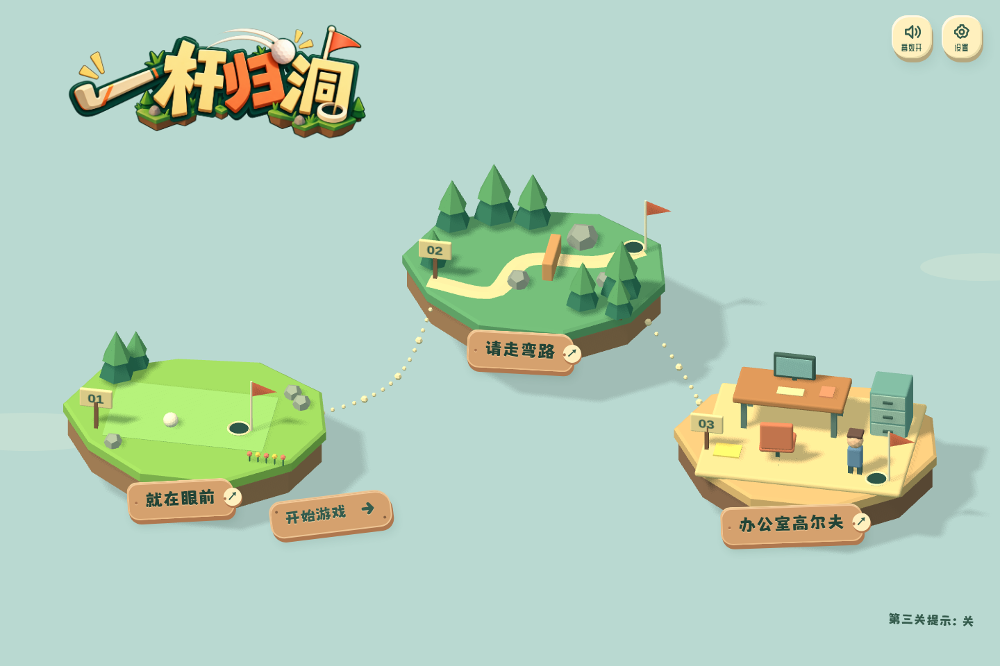
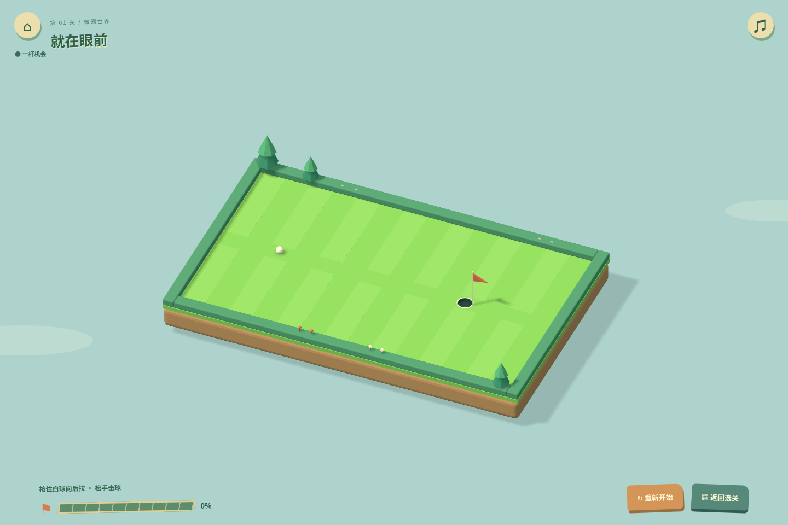
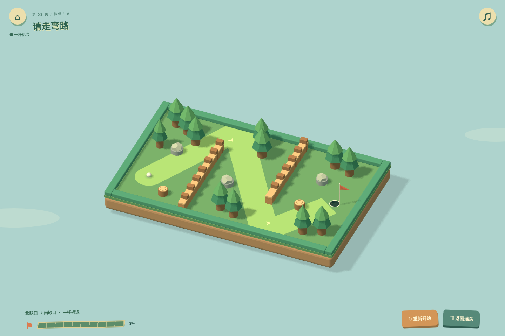
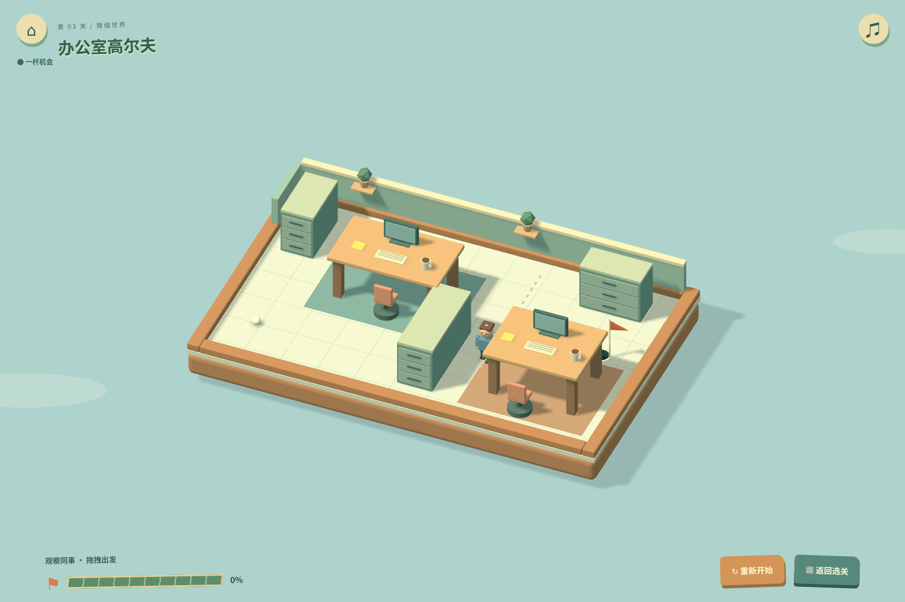

# 一杆归洞 · 微缩世界

Three.js + TypeScript + Vite 的三关 2.5D 高尔夫解谜。保留微缩岛屿地图、固定正交视角和一杆机制。当前第一阶段以圆润立体玩具 UI 为主，保留原有成绩横幅与办公室路线辅助；全部模型、标记与音效由程序原创生成，无后端或运行时 CDN。



## 最新关卡

| 关卡            | 玩法与路线                                                                                   | 一杆参考解的反弹次数 |
| --------------- | -------------------------------------------------------------------------------------------- | -------------------- |
| 01 就在眼前     | 开阔草地；学习向后拉杆、方向箭头和力度刻度                                                   | 0                    |
| 02 请走弯路     | Z 型修剪球道；先穿北缺口，再穿南缺口；上下边墙折返。树干、岩石、树桩、围栏均真实碰撞         | 2                    |
| 03 办公室高尔夫 | 地板、地毯、桌腿、椅子、文件柜构成非对称空间；可穿桌底，观察同事后出杆。另有借桌腿反弹的路线 | 1；家具借力解为 2    |







## 下载与试玩

在 GitHub 的 `game/one-shot-golf-prototype` 分支选择 **Code → Download ZIP**，解压。安装 Node.js 22.12+（或 20.19+），在项目目录运行：

```sh
npm ci
npm run dev
```

保持终端开启，打开显示的 Local 地址，通常为 `http://localhost:5173/`。不要直接双击 HTML。手机与电脑同一局域网时，可访问终端显示的 Network 地址。需要现代浏览器的 WebGL 2 与硬件加速；无法初始化时会显示友好提示。

## 操作与规则

- 直接点击首页岛屿，或点击木牌「从这里出发」。支持鼠标、触屏及 Tab / Enter 选择。
- 按住白球向后拖拽，松手击球。橙箭头指向出球方向；刻度显示力度。拖拽小于 6 球场单位取消，150 单位达到最大力度。
- 一次挑战只有一杆，运动中不能再次击球。白点默认仅预测最初约 0.26 秒；第三关可由玩家主动开启完整参考路线。
- 球心轨迹进入半径 **16 单位**的有效洞口立即成功，保留原判定大小，不要求停在中心或低速。捕获冻结物理，再播放吸入、缩小、下沉动画。
- 停在洞外失败，可立即重试；R 重试，Esc 返回地图，右上角控制音效。场地四边均为实体边界，异常越界仍会失败。
- 桌面、显示器在球上方，只有真实桌腿碰撞；球进入桌下或被桌面遮挡时，上部模型暂时淡化。树冠高于球的通过高度，实际撞树干；椅子有可见的圆形底座和轮子，底座对应碰撞范围。
- 木材、树木、石块、椅子和人物使用不同的弹性及合成碰撞音色；人物被碰到会举手惊讶，碰撞轮廓仍保持一致。

## 动态障碍与时间

办公室同事沿地面虚线巡逻，位置为 `x = 575`，`y = 230 + 160 × sin(2πt / 8)`，碰撞半径 20，平滑往返，不瞬移。时间 `t` 是从**每次进关或重试开始的固定步长模拟时间**，瞄准期间也推进；后台页面暂停，不追赶丢失的时间；成功或失败时停止。低帧率下模拟可能慢于实际钟表时间。

因此同样的等待时长、方向和力度可以精确重现。可以在出杆前观察同事；他不会永久封锁路线。测试证明同一参考杆在模拟时间 0 秒出杆成功，4.5 秒出杆会撞同事失败，8 秒出杆再次成功。碰撞使用球与人物的**相对速度**，不是把人物当作固定墙。

没有强制倒计时。通关面板显示本杆滚动耗时、反弹次数和该关最佳滚动耗时，等待瞄准不计入最佳；记录只保存在浏览器中。新布局进度使用单独版本键，保留旧存档但不将旧关卡完成状态误当作新关卡完成。

## 验证

```sh
npm test
npm run build

# 另一个终端，保持开发服务器运行
npm run test:browser
npm run test:menu
```

浏览器测试默认用 `/usr/bin/chromium`，其他位置设置 `CHROMIUM_PATH`；服务默认 `http://127.0.0.1:5173`。测试截图保存在忽略的 `test-results/`。

物理测试包括：

- 三关参考杆逐步回放，沿途检查碰撞体净距；两个高级关卡共 18 组相邻角度/力度解。
- 两个高级关卡的直线击球被阻挡，不能只瞄洞直打。
- 每一棵树、石块、树桩、围栏、桌腿、柜体和椅子的反射与材质事件。
- 同事迎面、背向运动时的相对速度响应；不同出杆时机、重复重试和完整周期一致性。
- 连续洞口捕获、先撞墙再经过洞口的事件顺序、快速碰撞、单杆锁定及终态冻结。
- 240 次固定种子的不同方向、力度、等待时长压力模拟，检查穿模、嵌入、出界与不终止。

浏览器回归实际拖拽通关三关，检查矩形与圆形模型边界、动态碰撞和惊讶动画、计时重置、失败重试、最佳记录、触屏、地图往返、资源释放及 WebGL 不可用提示。自动化使用软件 WebGL，不代表实体低端手机的帧率测试。

## 文件结构

| 文件                                                                                      | 职责                                                             |
| ----------------------------------------------------------------------------------------- | ---------------------------------------------------------------- |
| `src/levels.ts`                                                                           | 关卡坐标、矩形/圆形障碍、桌子参数和巡逻参数；桌腿从桌子配置派生  |
| `src/physics.ts`                                                                          | 240Hz、连续圆/矩形碰撞、运动圆碰撞、材质弹性、固定模拟时钟与捕获 |
| `src/course-models.ts`                                                                    | 森林、办公室、同事模型、桌上遮挡淡化与碰撞反馈                   |
| `src/scene.ts`                                                                            | 共享渲染器、正交相机、滚动/进洞表现、射线映射与短预测            |
| `src/world-map.ts`                                                                        | 保留的三岛地图、环境动画、悬停和入场镜头                         |
| `src/main.ts` / `src/audio.ts`                                                            | 输入、状态、最佳记录及程序化音效                                 |
| `tests/solutions.ts`                                                                      | 经物理回放验证的参考击球参数                                     |
| `tests/physics.test.ts` / `tests/browser.mjs` / `tests/visibility.mjs` / `tests/menu.mjs` | 物理与真实浏览器回归                                             |

二维 `(x, y)` 映射为三维 `(x - 450, height, y - 280)`，一个物理单位等于一个场景单位。模型读取同一份碰撞配置；圆形基座、树干和树桩的实际尺寸与碰撞圆对应，家具只在球所在高度形成相应阻挡。

连续检测先比较洞口、静态障碍和运动人物的最早接触时间，再推进到接触点、解算反弹及剩余时间；圆与矩形的角点使用圆形扫掠，避免放大成方角。人物每小步按平滑轨迹的两端做线性扫掠，并用对应相对速度反射。保留原有发射上限 780、滚动阻力 90 和洞口半径 16。木材恢复系数 0.90、石块 0.80、树干 0.84、椅子 0.79、人物 0.75。

没有新增外部资产或渲染器。切换场景释放模型、材质和标签纹理；单方向阴影与低面数模型控制成本。

## 调试参考杆

方向以下用角度弧度表示，力度为拖拽长度，具体数值见 `tests/solutions.ts`。角度 0 向右，负角度向右上。办公室的等待时长以模拟时间为准，实际试玩可以观察同事向下走时出杆。

- 第一关：角度 0，力度 65。
- 第二关：角度 -1.06，力度 125，上下边界各反弹一次。
- 第三关：角度 -0.748，力度 125，进关后尽早出杆；另可用角度 -0.78、力度 125 借桌腿再次反弹。

## 构建与范围

```sh
npm run build
npm run preview
```

`dist/` 可部署到静态网站服务，通过 HTTP 访问。Three.js 主包仍会触发 Vite 默认 500KB 提示，构建成功，支持服务器 gzip 压缩。

目前仍是三关原型，尚未证明达到最终 30 分钟以上体验目标。实体 iOS / Android 触感、音效听感和中低端设备性能仍需实机试玩。最终作业截止为 10 月 19 日 23:59；本轮没有扩展关卡数量或加入倒计时。

## 本轮：成绩横幅、中文字体与办公室路线辅助

保留三岛选关、美术、所有关卡配置和物理模块。第三关并非无解：原参考角度 −0.748 rad、拖拽长度 125（约 83% 力度），在巡逻周期合适阶段一杆反弹进洞；同事挡路时相同击球可能失败。

- 首页右下角可预先开启「办公室路线辅助」；进入第三关后也可随时切换。
- 连续失败 3 次后主动询问，重试、返回及刷新保留失败数，通关清零。
- 玩家主动开启后，后台 Worker 搜索多个角度和力度，使用同一个 `step` 物理函数完整回放；人物时间基准与当前关卡一致。仅显示模拟进洞的路线。
- 额外检查整个 0.6 秒出杆窗口内人物的连续纵向运动包络，并保留安全余量；超时轨迹立即隐藏。无可验证路线时显示等待，不编造穿过同事的路径。
- 虚线表示参考出球方向及反弹路径，提示显示参考力度；不会自动击球。玩家仍需自己对准，开启提示并不保证偏离参考角度的击球成功。
- 成绩以出杆到捕获的模拟时间计，两位小数；各关独立最佳保存在 `golf-best-v4`，以百分之一秒比较。首次、严格改善及普通通关分别反馈，存储受限时仍能在本次会话游玩。
- 捕获后保留球下落动画，再弹出立体胜利横幅；总演出约 1.4 秒，支持系统减少动画设置。
- 字体完整本地化，无外部字体请求；来源和许可证见 [public/fonts/README.md](public/fonts/README.md)。

新增验证：`npm test` 包含成绩分类、损坏存储、32 个巡逻阶段及不可通行布局测试；`npm run test:rewards` 验证真实拖拽、三次失败提醒、路线开关、参考路线通关、成绩保存及横幅。

### 正式 Logo

首页直接引用用户提交的 `src/assets/game-logo.png`（2023×777，RGBA 透明 PNG），未重绘、裁剪、压缩或修改原文件。Vite 将原图打包为带哈希的素材；缺失文件时构建会报错。通过 CSS 等比缩放适配桌面和手机，标题区域不接收指针事件，保留三座岛屿及所有选关交互。

本轮截图：[首页](docs/screenshots/menu.png) · [移动端选关](docs/screenshots/menu-mobile.png) · [胜利横幅](docs/screenshots/victory-banner.png) · [第三关推荐路线](docs/screenshots/office-route.png)。首页截图已更新为正式 PNG Logo。

本轮验证结果：物理与成绩单测通过（含 240 次压力击球、32 个巡逻阶段路线搜索）；三关真实鼠标击球、移动人物碰撞、失败重试、触屏击球、后台暂停、遮挡淡化、三岛选关和场景资源释放通过。新增成绩/辅助浏览器测试通过，包括首页实际点击、失败结算提示入口、推荐杆手动进洞、持久化及通关重置。`npm run build` 通过；仍有 Three.js 主包超过 500 kB 的体积提示，不影响构建。

正式 Logo 接入验证：桌面 1440×960、手机 390×844、横屏 844×390、小屏 320×640 均成功解码并按原始比例显示；Logo 与三关入口及名称不重叠。构建输出 PNG 与用户提交原图的 SHA-256 完全相同。物理/成绩单测及构建通过。
选关回归通过：三个岛屿的鼠标、键盘、触屏选择、悬停反馈、镜头切换及重复进出时的资源释放均正常。补充截图：[手机横屏](docs/screenshots/menu-landscape.png) · [320px 小屏](docs/screenshots/menu-small.png)。


## 第一阶段 · Soft Toy 3D UI

本阶段仅调整界面：不新增关卡，不改物理、碰撞、路线、难度、推荐路线算法或最佳成绩数据。原始 PNG Logo、三岛模型、位置、镜头路径与场景材质保留。

- 使用现有 OFL 本地黄油体呈现圆润木牌标题、按钮和小字；得意黑用于力度数字，沿用成绩数字层级。没有增加字体或依赖，完整许可证仍在 `public/fonts/`。
- 三关入口为随岛屿定位的立体木牌，悬停时木牌及岛屿轻轻上浮回弹。只有菜单反馈使用阻尼弹簧，与球的物理无关。
- 软胶音效/设置按钮有上侧高光、下侧厚度与按压回弹；使用原创 SVG 图标，音效开关同时显示文字及图形状态。沿用原合成击球、碰撞与进洞音效，不新增背景音乐。
- 原生设置对话框采用奶油纸面与木框，提供音效、办公室路线辅助开关，支持键盘焦点、Esc、点击外部及关闭按钮。打开时暂停游戏时钟，关闭恢复，避免同事巡逻在调整设置时偷走出杆时机。
- HUD 采用小木牌、圆润分段力度仪表及软胶返回/重试按钮；文字使用深松绿以提高浅色表面的可读性。
- 第三关「路线小贴士」每次进入默认收起，点击边缘按钮展开。展开时球场为木牌留出空间，提示面板不覆盖球、小洞和球路；击球时自动收起。提示计算和时机验证保持原样。辅助开关仍按原存档保存，收起木牌不会偷偷改变开关状态。

截图：[首页](docs/screenshots/menu.png) · [悬停选关](docs/screenshots/toy-selection.png) · [HUD](docs/screenshots/toy-hud.png) · [设置](docs/screenshots/toy-settings.png) · [提示木牌](docs/screenshots/toy-route.png)。

手机截图：[首页](docs/screenshots/menu-mobile.png) · [HUD](docs/screenshots/toy-hud-mobile.png) · [设置](docs/screenshots/toy-settings-mobile.png) · [提示木牌](docs/screenshots/toy-route-mobile.png)。

新增 `npm run test:ui` 用于验证设置焦点及关闭、巡逻暂停/恢复、音效保存、原成绩保留、提示收起/展开，以及电脑和手机上提示面板与球场分离。需要先启动开发服务器，Chromium 配置与其他浏览器测试相同。

视觉确认重点：木牌大小与位置、软胶按钮厚度和回弹力度、提示展开时球场让位的幅度。本阶段未继续修改通关横幅。

本阶段验证通过：`npm test`、`npm run build`、`npm run test:menu`、成绩/路线回归、三关真实拖拽回归及 `npm run test:ui`。额外核对了 320×640 小屏和 844×390 横屏，Logo/顶部控件不相撞，展开提示木牌在球场区域之外。构建仍有原有 Three.js 主包体积提示，没有构建错误。

## 字体与文案整理（本阶段）

仅调整字体角色、文字排版及冗余文案；保留 Logo 原图、三岛地图、组件造型、动画、场景与物理规则。

- 标题／重要按钮：本地猫啃什锦黑 1.70，作者官方仓库发行，SIL OFL 1.1，完整 WOFF2 与原始许可证在 `public/fonts/maoken/`。
- 正文／数字：按最新确认，**正式采用项目已有的合法黄油体 400**，设置、说明、路线辅助和成绩统一使用此字体；无需再提供方圆体文件。标题与重要按钮、新纪录文字使用猫啃什锦黑。
- 统一字体注册与角色变量：`src/fonts.css`；文字层级和窄屏适配：`src/typography.css`。标题预加载、本地度量适配回退，关闭合成粗体；完整来源、版本、散列见 `public/fonts/README.md`、`font-manifest.json` 和 `SHA256SUMS`。
- 精简首页口号、重复操作说明和设置副标题，名称统一为「一杆归洞」。未提前制作后续横幅、灯泡木牌或新关卡。
- 浏览器排版检查：启动开发服务器后运行 `node tests/typography.mjs`；现有交互与截图检查运行 `npm run test:ui`。实际截图在 `docs/screenshots/`，并非生成图。
